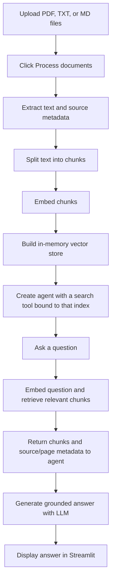

# Chat with Your Documents

A Streamlit document Q&A app built with LangChain and DeepAgents. Upload PDF, TXT, or Markdown files, build a semantic index, and ask questions answered from the relevant document passages.

The project is designed as a small, modular application: document extraction, indexing, retrieval and agent construction.

## Features

- Upload multiple PDF, TXT, and Markdown files through the Streamlit interface.
- Extract document text and preserve PDF page metadata for source-aware answers.
- Split extracted text into overlapping chunks and index them with `openai/text-embedding-3-small` embedding model.
- Retrieve relevant chunks for a question and use LLM to form an answer.
- Keep the vector index in memory for the active Streamlit session; documents are not re-embedded for every question.

## How it works



Indexing happens when you click **Process documents**. For each question, the app performs a vector search over the existing index and sends the question and retrieved context to the chat model; it does not rebuild the index or re-embed every uploaded document.

## Requirements

- Windows, macOS, or Linux
- Python 3.13 (the repository pins this in `.python-version` and requires `>=3.13`)
- [`uv`](https://docs.astral.sh/uv/) for creating the environment and installing the locked dependencies
- An [OpenRouter API key](https://openrouter.ai/keys) with access to the configured chat and embedding models

## Installation

Clone the repository and change into its root directory:

```powershell
git clone https://github.com/olalekan1/ChatWithYourDocuments.git
cd ChatWithYourDocuments
```

Install `uv` if needed. On Windows, one option is:

```powershell
winget install --id=astral-sh.uv -e
```

Open a new terminal after installation, then install the project dependencies from the lock file:

```powershell
uv sync
```

`uv` will create the project virtual environment and use the Python version declared by the project. If that Python version is not installed yet, install Python 3.13 and rerun `uv sync`.

## Configure OpenRouter

Create a file named `.env` in the repository root and add your key:

```dotenv
OPENROUTER_API_KEY=your_openrouter_api_key
```

Do not commit `.env` or publish your API key. The repository's `.gitignore` already excludes `.env`; keep that protection in place.

## Run the app

From the repository root:

```powershell
uv run streamlit run src/chatbotwithlangchain/cli.py
```

Streamlit prints a local URL (usually `http://localhost:8501`). Open it in your browser.

### Using the app

1. In the **Knowledge base** sidebar, upload one or more PDF, TXT, or Markdown files.
2. Click **Process documents** and wait for indexing to complete.
3. Ask a question in the chat box.
4. To use a different file set, select the new files and click **Process documents** again. The app warns and disables chat when the selected files differ from the processed set.
5. Use **Clear conversation** to clear the displayed conversation.

PDF source citations can include page numbers. Text and Markdown files are treated as whole documents, so they have source filenames but no PDF page numbers.

## Project structure

```text
src/chatbotwithlangchain/
├── agents.py       # Builds the Deep Agent and attaches the document search tool
├── cli.py          # Streamlit interface and upload/process/chat lifecycle
├── file_handler.py # Extracts text and source metadata from uploaded files
├── indexing.py     # Splits documents, embeds chunks, and builds the vector store
├── prompts.py      # Agent and chunk analyst instructions
└── tools.py        # Search tool bound to a processed vector store
```

## Models and external services

The current configuration uses:

- Chat: `openai/gpt-5-nano` through OpenRouter
- Embeddings: `openai/text-embedding-3-small` through OpenRouter

OpenRouter is an external service. The app sends document text for embedding during processing, and sends the question plus retrieved document context to the chat model when answering. Do not upload confidential, sensitive, or personal documents unless you are comfortable sending that content to the configured provider and have permission to do so.

## Current limitations

- The vector store is in memory. It is not persisted to disk, shared across sessions, or retained after the app process/session ends; process documents again when starting a fresh session.
- PDF text extraction requires text-readable PDFs. Scanned/image-only PDFs need OCR, which is not currently implemented.
- Search currently returns up to five chunks per search call. Broad questions may require the agent to make additional focused searches.
- The app requires a working OpenRouter API key and network access for embedding and model calls.

## Troubleshooting

- **Missing API key:** confirm `.env` is in the repository root and contains `OPENROUTER_API_KEY=...`.
- **Python version or dependency errors:** confirm Python 3.13 is available, then run `uv sync` from the repository root.
- **No readable text:** check that the PDF contains selectable text, or try a UTF-8 encoded TXT/Markdown file.
- **Uploads changed warning:** click **Process documents** again before asking questions about the new selection.
- **OpenRouter/API errors:** check the key, account access, network connection, and availability/permissions for the configured models.

## Public repository checklist

- Never include `.env`, API keys, or other credentials in commits.
- Only publish documents in `pdfs/` or elsewhere if you own them or have permission to share them. Use synthetic or public sample documents for a public demo; uploaded recruiter/CV material can contain personal information.
- Do not commit generated indexes, private uploads, or other user data.